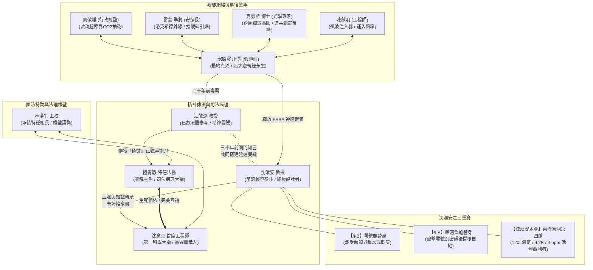

# 《零號坍縮》（Collapse Zero）全書人物介紹
## Character Profiles & Personnel Dossier

---

## 目錄
1. [靈魂主角與破局者（司法病理與物理鑑識核心）](#1-靈魂主角與破局者司法病理與物理鑑識核心)
2. [死者與終極設計者（深淵中的殉道觀測者）](#2-死者與終極設計者深淵中的殉道觀測者)
3. [嫌疑人與叛徒網絡（被觀測的五位核心關係人）](#3-嫌疑人與叛徒網絡被觀測的五位核心關係人)
4. [國家安全與司法武裝支撐（特勤與法理鐵壁）](#4-國家安全與司法武裝支撐特勤與法理鐵壁)
5. [精神圖騰與傳承源頭（三十年前的法醫泰斗）](#5-精神圖騰與傳承源頭三十年前的法醫泰斗)
6. [全書人物關係 Mermaid 拓撲網絡](#6-全書人物關係-mermaid-拓撲網絡)
7. [全書核心象徵物與物理信物對照表](#7-全書核心象徵物與物理信物對照表)

---

## 1. 靈魂主角與破局者（司法病理與物理鑑識核心）

### 陸青巖（Lu Qing-yan）
* **身分定位**：法務部法醫研究所特任病理組首席法醫、刑事警察局特聘法醫專家、全書靈魂主角、江敬遠教授的唯一關門親傳弟子。
* **外貌特質**：三十歲中旬，身材修長筆挺，眼眶常年帶著淡淡的疲倦烏青，雙目深邃冷酷如枯井，深褐色瞳孔在面對複雜現場時無絲毫情緒波動。左手虎口處有一道長約兩公分的陳舊性白色手術鋸齒痕。常穿深灰色羊毛風衣或黑色特任法醫正裝，指尖帶著微弱的消毒水與長壽香菸氣息。
* **性格與哲學信條**：
  * **「極致理性、慎微自持、拒絕虛妄」**：堅信「任何看似超自然的奇蹟背後，都只是經典物理與化學規律在人眼盲區的捉迷藏」。
  * **「法醫是死者最後的律師」**：不信奉薛丁格的量子安慰，認為只要是碳基血肉之軀，就必須服從病理學的重力。
* **經典信物**：
  * **11 號高碳鎢鋼解剖刀**：握柄處由恩師江敬遠親手雕刻「慎微」二字，全書穿透謊言與迷霧的終極鋒刃。
  * **黃色軟包長壽香菸**：思考案情、串聯微觀邏輯節點與敬奠逝者時點燃的純樸煙火。
  * **碳纖維三防法醫器材箱**（編號：FOR-TW-0914）。
* **人物金句**：「解剖刀切開的是皮肉與骨骼，但縫合起來的，是人間不甘的尊嚴與真理。」

---

### 沈念真（Shen Nian-zhen）
* **身分定位**：玉山「深淵之眼」地下量子低溫實驗基地首席常溫超導工程師、沈淮安教授的獨生女兼唯一法定技術繼承人。
* **外貌特質**：二十六歲，清秀消瘦，皮膚因長期深居地底無菌環境而帶著一種象牙般的蒼白。雙眸深黑如墨，邊緣泛著冷冽的金屬光澤。平日長髮以黑色阻燃束髮帶隨意紮在腦後，後期佩戴一枚由純鈹合金微絲編織而成的戒指。
* **性格與成長軌跡**：
  * **「從脆弱執念走向鋼鐵覺醒」**：故事開篇對父親的生死疊加態抱有極大的痛苦與執念（「如果我們承認他死了，是不是我們殺了他？」）；在經歷了地底背叛、斷腕制伏周敬雄、識破相位共軛鏡後，迅速蛻變為能獨當一面、在全世界鏡頭前捍衛國家主權的頂級女科學家。
  * 擁有極高深的神經微波、超導材料與量子光學造詣，是陸青巖破解物理密室不可或缺的「第一科學大腦」。
* **經典信物**：
  * **低溫原子級磁力顯微鏡（MFM）**：解開原版硬碟 MRAM 底層纠缠磁場的關鍵利器。
  * **白玉蘭胸針**：父親最愛的花，象徵純潔、尊嚴與不屈的信念。
* **人物金句**：「只要玉山之巔的那一百二十公升液氦還在流淌，這項技術的主權，就永遠屬於這座島嶼上所有正直的觀測者！」

---

## 2. 死者與終極設計者（深淵中的殉道觀測者）

### 沈淮安 教授（Prof. Shen Huai-an）
* **身分定位**：享譽國際的常溫超導與理論物理泰斗、三十年前台大醫學院法醫病理所助理教授、《觀測者之書》作者、零號密室終極設計者。
* **生平背景與絕症**：
  三十年前與江敬遠共同創立獨立鑑識體系，後因黑金陷害轉向理論物理。五年前成功燒結出「零號常溫超導拓撲晶圓母體」，但隨即確診肌萎縮側索硬化症（ALS，漸凍人症晚期）。察覺到跨國軍工巨頭洛克希德與內部間諜的奪權陰謀後，毅然布下橫跨三十年的「宏觀延遲選擇局」。
* **終極三重身構造**：
  1. **【$\Psi_B$】地表替身**：承載同源基因與骨骼特徵之生物克隆體，置於零號艙承受超臨界脫水，鎖死周敬雄之故意殺人鐵證；
  2. **【$\Psi_A$】暗河替身**：置於地下暗河負艙，承載沈淮安最後 18 小時腦電糾纏，發送【零號沉】莫斯密碼後開槍自絕，完成受賄物證哈希值固定；
  3. **沈淮安本尊**：封印在玉山東峰第十八號防空盲洞，以 120 公升過冷超導液氦（4.2 K）維持 4 bpm 心跳與 14.2 Hz 相干態，作為「活體觀測者」築起專利主權法律鐵壁。
* **經典信物**：
  * **《觀測者之書》**：純牛皮染血筆記本，記載基地地下管網雙向對稱模型與海森堡不確定性原理血書。
  * **鶯歌粗陶大海碗**：三十年前放置於氣象站重力地窖，盛裝 72 小時宏觀延遲波導循環米飯的時空信物。
* **人物金句**：「在浩瀚冰冷的宇宙方程式裡……愛，才是唯一能對抗熱力學第二定律的負熵。」

---

## 3. 嫌疑人與叛徒網絡（被觀測的五位核心關係人）

### 宋銘澤 教授（Dr. Sung Ming-tse）
* **身分定位**：全台最年輕中央研究院院士候選人、台大醫學院毒理學研究所前所長、江敬遠大弟子、全書最終幕後反派真兇。
* **外貌特質**：四十歲出頭，金絲無框眼鏡，高挺鼻樑，風度翩翩、舉止儒雅，聲音如大學階梯教室教授般溫潤，實則內心冷血殘忍至極，為典型反社會高智商狂徒。
* **罪孽與犯罪手法**：
  * **二十年前弒師**：在江敬遠降壓藥中調換二甲基水銀與釙-210，製造「學術抑鬱自毀」假象並踩著恩師白骨上位；
  * **此次奪權陰謀**：受洛克希德 5,000 萬美元收買，企圖利用常溫超導微管蛋白重寫技術追求「生命科學逆轉錄永生」；冒充特勤隊長趙烈潛入地底，投放 FSBA 共價交聯毒劑毀滅沈淮安額葉神經。
* **結局**：於大直地下特種軍事法庭被陸青巖以低溫電鏡（Cryo-TEM）與 NMR 數據以「神經毀滅型故意殺人罪（Neurocide）」徹底擊潰，判處死刑並於一年後執行。

---

### 周敬雄（Chou Ching-hsiung）
* **身分定位**：玉山「深淵之眼」地下量子實驗基地行政總監。
* **特質**：微胖身材、梳著一絲不苟的花白背頭，手持皺巴巴的絲質手帕，滿臉官僚政客式的虛偽冷汗。
* **犯罪行徑**：背負巨額離岸洗錢信託（為救溫哥華被綁架的兒子），動用唯一權限在今晨 02:14 強制啟動德國原裝十噸超臨界 $\text{CO}_2$ 反應釜，試圖在 3 小時內抽乾替身滅口；後於避難所被沈念真以重型切割刀斬斷腕骨擒獲，追回 1 億 4 千萬美元贓款，判刑入獄。

---

### 雷蒙 二級準將（Brigadier General Raymond）
* **身分定位**：基地安保主管、國防部特勤作戰局二級準將、洛克希德「外線武力鬣狗」。
* **特質**：魁梧如鐵塔，面容如花崗岩雕刻，指關節粗大，佩戴特種防爆外骨骼與戰術電擊槍。
* **結局**：企圖攜帶沈淮安底層硬碟逃生，於重力排渣井被陸青巖揭穿其特工自毀信標真相，絕望之際引爆炸彈炸毀第七超導環，被零下 200 度極寒液氦風暴撕碎。

---

### 克勞斯·馮·鮑爾 博士（Dr. Klaus von Baur）
* **身分定位**：德國慕尼黑大學物理研究所教授、國際量子光學權威、基地外籍首席科學顧問。
* **特質**：消瘦如骷髏，圓框厚眼鏡，神經質地啃咬大拇指指甲，帶著濃重巴伐利亞口音，偏執狂熱地捍衛熱力學標準模型。
* **行徑與結局**：自詡聰明企圖剽竊「零號晶圓母體」，以假面皮特工調虎離山潛入負 520 公尺第三艙，動用飛秒激光切割手套箱，卻因不諳「非阿貝爾任意子拓撲相位共軛鏡」，被 180 度原路反噬的激光貫穿胸椎心臟，凍成冰雕。

---

### 陳啟明（Chen Chi-ming）
* **身分定位**：基地生命維持系統工程師。
* **特質**：厚重近視鏡片、唯唯諾諾，看似懦弱膽怯，實則為企圖徹底摧毀常溫超導火種的第三方勢力死士。
* **罪證**：工作證後藏有「超導約瑟夫森結微波注入器」，三天前親手將裝有【$\Psi_B$】替身的鉛箱以「鈹合金配重塊」名義推入零號艙；最終被特勤隊壓制銬死在避難所。

---

## 4. 國家安全與司法武裝支撐（特勤與法理鐵壁）

### 林漢生 上校（Colonel Lin Han-sheng）
* **身分定位**：國防部軍事情報特種行動組組長。
* **特質**：剛毅冷峻、身手矯健，嘴角常嚼著高能壓縮乾糧，講道地台灣本土台語，作風雷厲風行。
* **戰績**：臥底於宋銘澤身側假冒特勤隊員，在第三艙關鍵時刻一槍托粉碎宋銘澤手肘關節將其擒獲；指揮玉山東峰特戰第一營以反器材電磁脈衝炮全殲潛入的洛克希德外骨骼滑翔翼分隊，守衛盲洞毫髮無損。

---

## 5. 精神圖騰與傳承源頭（三十年前的法醫泰斗）

### 江敬遠 教授（Prof. Chiang Ching-yuan）
* **身分定位**：台灣現代司法病理學界至高無上的泰斗宗師、陸青巖的恩師、沈淮安三十年前的同門知己。
* **深遠影響**：
  * 三十年前手握刻有「慎微」二字的 11 號解剖刀，與年輕的沈淮安在玉山北峰重力地窖搭建了「惠勒宇宙雙縫干涉儀」，為今日的破局埋下伏筆；
  * 二十年前遭大弟子宋銘澤以二甲基水銀與釙-210 毒殺，臨終前故意留下教學錯誤以測試人心，並將唯一的佩刀託付給陸青巖。
* **人物金句**：「青巖，解剖刀只能解開已經死去的罪孽；但若有人妄圖用物理定律本身作為掩護去屠殺活人，我們手裡的刀，就必須學會切開光的相位。」

---

## 6. 全書人物關係 Mermaid 拓撲網絡

---

## 7. 全書核心象徵物與物理信物對照表

| 核心象徵信物 | 物理／法醫技術本質 | 象徵意涵與哲學載體 | 出現關鍵篇章 |
| :--- | :--- | :--- | :--- |
| **刻字 11 號解剖刀** | 高碳鎢鋼、刀柄蝕刻「慎微」二字 | 江敬遠 $\rightarrow$ 陸青巖。象徵直面血肉重力的冷靜理性，切開光學謊言的法理利刃。 | 全書貫穿（第 01～16 章） |
| **零號拓撲晶圓母體** | 鈹同位素與合成鑽石微晶燒結晶圓 | 常溫超導磁單極微擾技術母本。象徵不屈的國家主權、純淨的清潔能源未來。 | 第 08、10、12、16 章 |
| **【QD-PT-09】相變膠囊** | 鈦合金外殼封裝正十八烷，熔點 18.2°C | 軍用定位信標。沈淮安吞服後 72 小時釋放相變潛熱，既是引導特勤合圍的信號，也是破案的時間物理錨點。 | 第 03、09、14 章 |
| **龐加萊相位延遲波導腔** | 20 公分垂直石英管、14 T 超導磁場 | 群速度宏觀滯後 72 小時循環。承載溫熱米飯與杜鵑花粉的時空迴圈，破解「逆向因果」。 | 第 09、14 章 |
| **鶯歌粗陶大海碗** | 台灣粗陶、殘留 2026 年新米飯粒 | 沈淮安三十年前留給未來觀測者的信物，象徵跨越時空的父愛與人間煙火氣息。 | 第 09、15 章 |
| **玉山高山杜鵑花** | 杜鵑花科高山植物，全氟微膠囊包覆 | 破冰怒放於三千八百公尺懸崖。象徵生生不息、永不被深淵所吞噬的高貴靈魂。 | 第 01、04、09、16 章 |
| **黃色軟包長壽香菸** | 台灣在地菸草，燃燒生成青白微煙 | 陸青巖思考與敬奠先師之物。人間溫暖的灰燼，在冰冷科學深淵中唯一的溫度。 | 第 09、10、13、16 章 |
| **《觀測者之書》** | 純牛皮裝訂、海森堡測不準原理血書 | 沈淮安三十年心血筆記。承載雙對稱幾何模型與終極救贖思想，法庭最高封存物證。 | 第 06、07、14 章 |
| **未坍縮家書（微型音頻卡）** | 碳纖維封裝、超導微磁場 DSD-512 | 沈淮安進艙前 77 分鐘錄音。全書最催淚核心，宣告「愛是宇宙對抗熵增唯一的負熵」。 | 第 14、15 章 |

---
*本人物介紹文檔專為長篇硬核物理懸疑小說《零號坍縮》全書角色檔案、組織脈絡與象徵信物總覽。*
